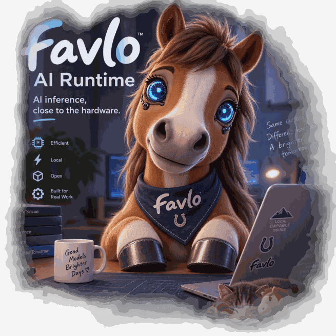

# Favlo

Favlo AI Runtime: Your Local AI Workhorse

<p align="center">
  
</p>

>This app is directly inspired by [oMLX](https://github.com/jundot/omlx). It's an amazing app - I recommend trying that first for general purpose inference before using my more specialized runtime.

Favlo is a local inference runtime for Apple Silicon. One model is one pipeline. Each pipeline owns its forward, its weight records, and its Metal kernels. `favlo serve` is the entry point. A client selects a registered model with the OpenAI `model` field.

The process contract is [ARCHITECTURE.md](ARCHITECTURE.md). The papers are [REFERENCES.md](REFERENCES.md). Agents start at [AGENTS.md](AGENTS.md). AI-assisted features are [docs/ai-assistance](docs/ai-assistance/README.md).

| Pipeline | Note |
|---|---|
| `qwen38-flash-next` | [Qwen3.8-Flash-Next](docs/qwen38-flash-next/architecture.md) |
| `qwen38-27b` | [Qwen3.8-27B](docs/qwen38-27b/README.md) |
| `qwen36-35b-a3b` | [Qwen3.6-35B-A3B](docs/qwen36-35b-a3b/README.md) |

## Requirements

- Apple Silicon
- 16 GB of memory
- Python 3.12 or newer
- [uv](https://docs.astral.sh/uv/)

8 GB is not enough to run a model capable of real-world agentic workflows.

## Install

From a checkout of this repository:

```bash
uv sync --extra dev
```

This installs the `favlo` package and the `dev` extra, including pytest. The package is not published to PyPI.

## Usage

```bash
uv run favlo serve
uv run favlo serve --non-interactive
```

`favlo serve` on a terminal is the CLI. `favlo serve --non-interactive` starts the server daemon and exits. The daemon listens on `127.0.0.1:8129`. On a terminal, an empty registry downloads [Qwen/Qwen3.6-35B-A3B](https://huggingface.co/Qwen/Qwen3.6-35B-A3B), packs `models/Qwen3.6-35B-A3B-fp4`, and then the daemon listens. Quantize and the other non-serve commands use that model's flag, as in `favlo --qwen38-flash-next quantize`.

## Chat

On a terminal, `favlo serve` reads stdin and talks to the daemon through its chat endpoint. A turn waits until no other request is open. The prompt is `you:`. Closing the terminal leaves the daemon running.

The first start prints nothing until the registered model writes an opening and `save_intro` stores it in `~/.favlo/intros.json`. That request checks that the model answers. Later starts print the stored first line. The model runs again when someone types.

After 30 minutes with no request and no typing, Favlo checks memory and free disk. When the machine can hold [Qwen/Qwen3.8-27B](https://huggingface.co/Qwen/Qwen3.8-27B), Favlo starts that download and asks whether to remind them again. A no is remembered, and those reminders stay off until they are turned back on. A shorter idle gap would take the only request slot during a pause in the conversation.

Favlo speaks as a small horse who wants a carrot, and refuses violent, sexual, and obscene requests. `/quit` stops the daemon. Questions about connecting a client, adding a model, or the name are answered from [docs/guides](docs/guides). The list of these features is [docs/ai-assistance](docs/ai-assistance/README.md).

## Development

```bash
uv run pytest
uv run ruff check
```

## Problems

Report a problem in this repository's issue tracker.

## License

Copyright 2026 Noriel Mallari

Favlo is licensed under the Apache License, Version 2.0. The terms are in [LICENSE.md](LICENSE.md).
